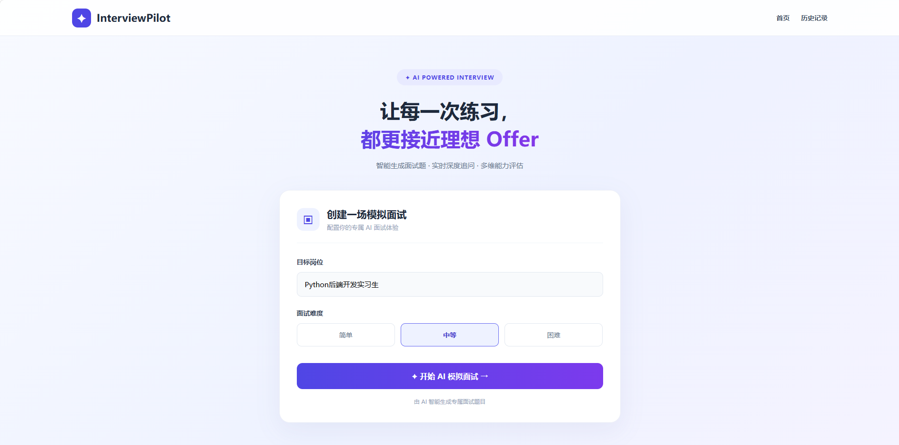
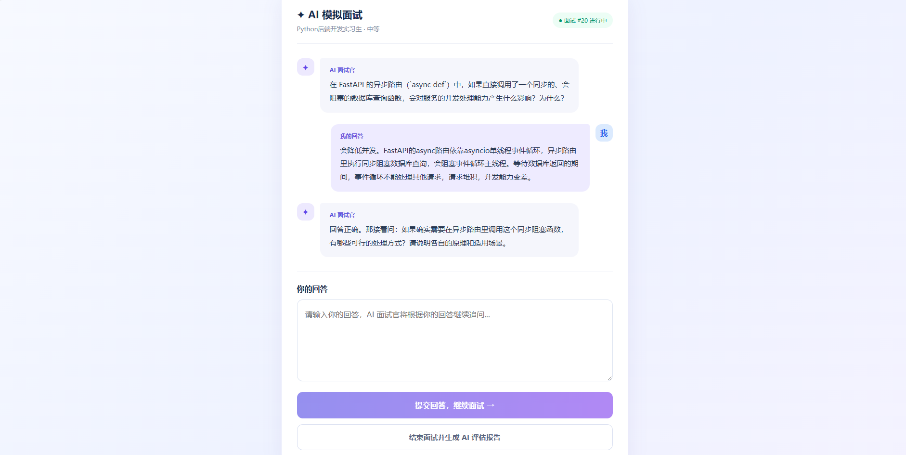
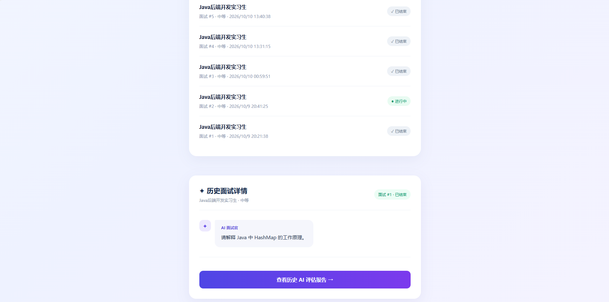
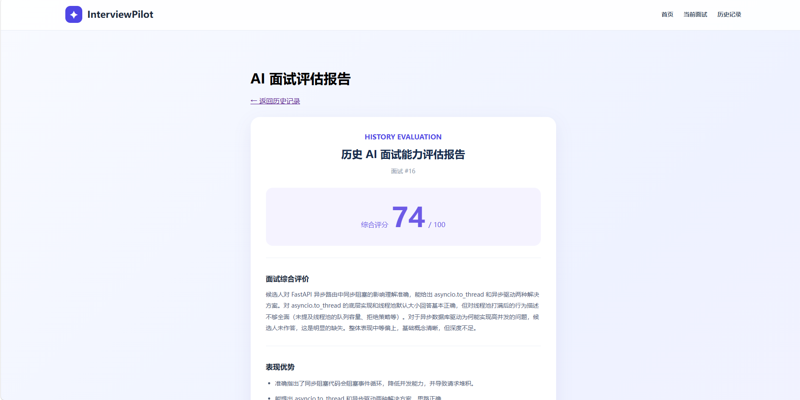

# InterviewPilot — 基于 RAG 与 Agent 的 AI 模拟面试系统

InterviewPilot 是一个基于大语言模型的 AI 模拟面试 Web 应用，支持根据目标岗位和面试难度生成技术面试题、结合候选人回答进行动态追问，并在面试结束后生成评估报告。

项目通过 RAG（检索增强生成）为 AI 面试官提供岗位知识支持，并使用 LangChain Tool Calling 构建 AI Agent，使其能够根据任务按需调用知识检索工具。

## 核心功能

* **AI 面试题生成**：根据目标岗位和难度自动生成技术面试题。
* **动态追问**：结合完整面试历史与候选人回答，生成针对性追问。
* **RAG 知识检索**：通过 Embedding 和 Chroma 检索岗位相关知识。
* **Agent 工具调用**：AI 面试官可以自主选择是否调用知识检索工具。
* **AI 面试评估**：面试结束后生成评估报告。
* **面试历史管理**：支持查看历史记录、恢复未结束的面试。

### 多页面交互

前端使用 React、TypeScript 和 React Router，将面试创建、AI 问答、历史记录和评估报告拆分为独立页面。

* **首页：** 选择岗位和难度，创建模拟面试。
* **模拟面试页：** 展示完整对话，支持提交回答、AI 动态追问以及结束面试。
* **历史记录页：** 查看历史面试详情，恢复未完成的面试，或跳转至评估报告。
* **评估报告页：** 查看已生成的 AI 面试评分和改进建议。

面试页和报告页支持通过 URL 直接访问及刷新恢复。前端根据面试 ID 调用 FastAPI 接口，从 MySQL 中读取已保存的数据。


## 技术栈

| 分类        | 技术                      |
| --------- | ----------------------- |
| 后端        | Python、FastAPI、Pydantic |
| 大语言模型     | DeepSeek                |
| AI 应用框架   | LangChain               |
| Agent     | Tool Calling            |
| Embedding | 阿里云百炼 Qwen-Embedding    |
| 向量数据库     | Chroma                  |
| 关系型数据库    | MySQL、SQLAlchemy        |
| 前端        | React + TypeScript + Vite + React Router   |
| 基础测试      | pytest                  |

## 系统架构

```text
React Frontend
      |
      v
FastAPI Backend
      |
      +----------------------+
      |                      |
      v                      v
AI Interview Agent       MySQL
(DeepSeek + LangChain)   (面试与消息记录)
      |
      v
Tool Calling
      |
      v
RAG Knowledge Tool
      |
      v
Qwen-Embedding + Chroma
      |
      v
岗位知识库
```

## RAG 工作流程

1. 使用 LangChain 读取岗位知识文档。
2. 将文档切分为多个 Chunk。
3. 调用 Qwen-Embedding 将文本转换为向量。
4. 将知识片段和向量存储到 Chroma。
5. 根据面试任务检索相关知识，为 AI 面试官提供参考。
(目前知识库主要收录 Python 后端开发相关技术内容，包括 Python、FastAPI、MySQL 和异步编程等知识。当前使用小规模 Markdown 文档验证 RAG 检索流程，后续计划扩展更多岗位知识。)


## Agent 工作流程

1. FastAPI 接收创建面试或提交回答的请求。
2. 系统向 Agent 提供岗位、难度或面试历史。
3. DeepSeek 根据任务判断是否调用知识检索工具。
4. 后端执行相应 Tool，并将检索结果返回模型。
5. Agent 生成面试题或追问。
6. FastAPI 将相关面试数据保存到 MySQL。

当前 Agent 使用单轮工具调用流程，后续可进一步扩展工具类型与状态管理能力。

## 本地运行

### 1. 启动后端

进入后端目录：

```bash
cd backend
```

创建并激活 Python 虚拟环境，安装依赖：

```bash
pip install -r requirements.txt
```

根据 `backend/.env.example` 配置本地环境变量。

首次运行需要准备 MySQL 数据库，并根据项目数据库模型初始化相关数据表。

构建 RAG 知识库：

```bash
python build_knowledge.py
```

启动 FastAPI：

```bash
python -m uvicorn main:app --reload
```

接口文档：

http://127.0.0.1:8000/docs

### 2. 启动前端

```bash
cd ../frontend
npm install
npm run dev
```

浏览器访问终端输出的本地地址，通常为：

http://localhost:5173/

## 项目展示

### 1. 首页 — 创建模拟面试

选择目标岗位和面试难度，创建新的 AI 模拟面试。



### 2. AI 模拟面试

AI 面试官根据岗位和难度生成问题，并结合历史回答继续追问。



### 3. 历史面试管理

查看历史面试记录，支持恢复未完成的面试，以及跳转查看已完成面试的评估报告。



### 4. AI 面试评估报告

面试结束后生成评估报告，展示评分和改进建议。




## 后续优化

* 扩展更多岗位的技术知识库。
* 根据 Markdown 标题优化 Chunk 切分。
* 增加检索相关性过滤及知识库引用。
* 进一步优化 Agent 的工具调用策略。
* 增加更多自动化测试与部署支持。
