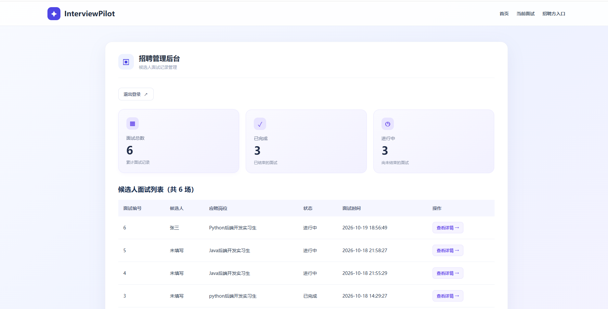
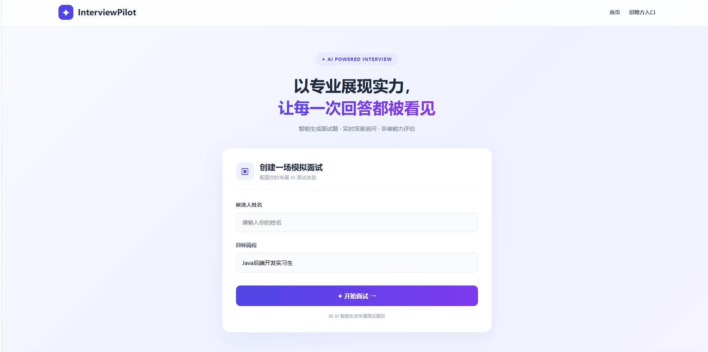
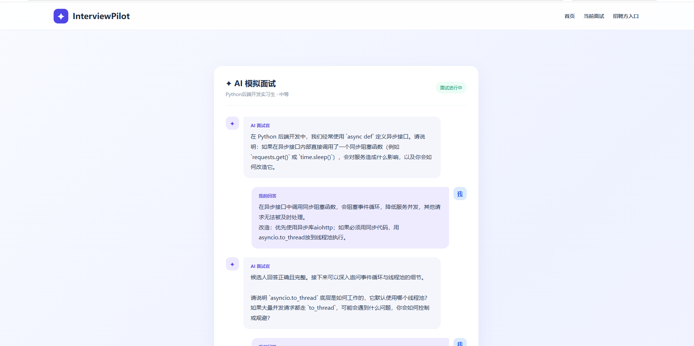
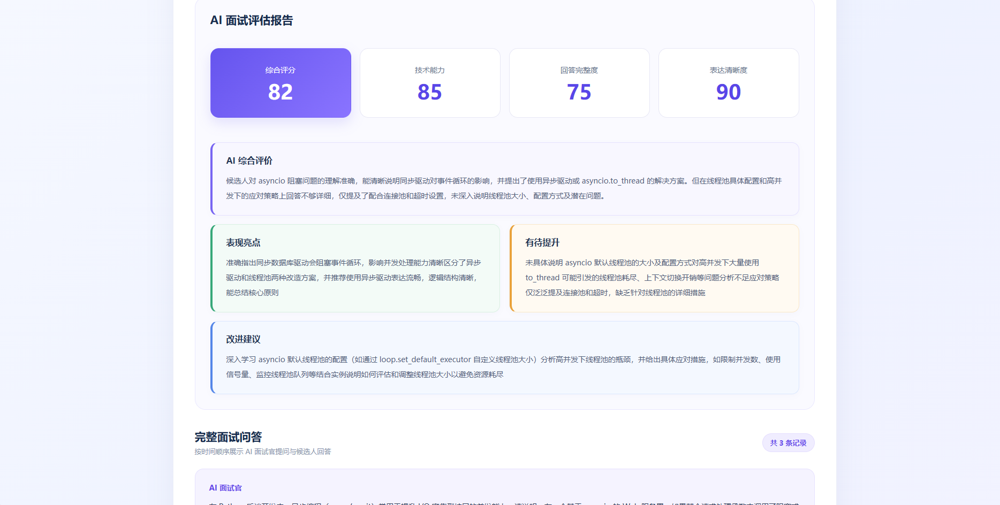
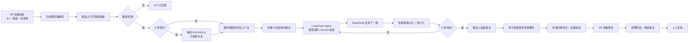
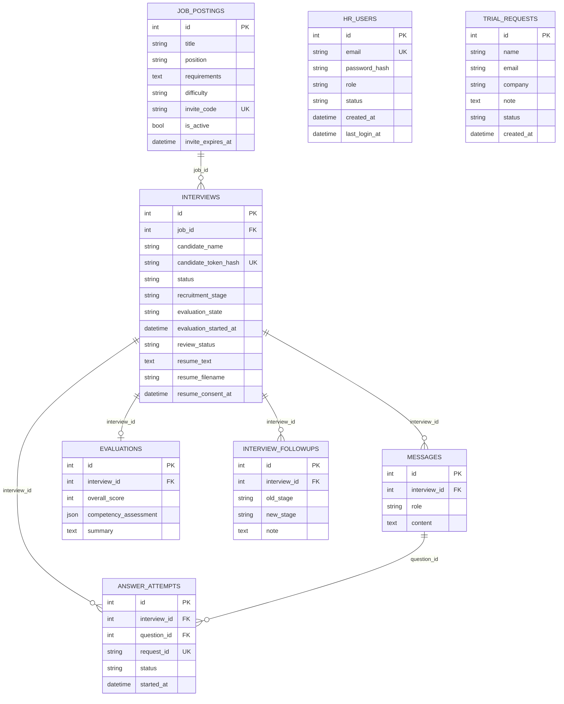

# InterviewPilot · AI 面试与招聘管理系统

> 面向企业招聘初筛的全栈 AI 应用：把 **HR 创建岗位 → 邀请候选人 → 简历解析 → 8 轮四维 AI 面试 → 带证据的辅助评估 → 招聘阶段与人工复核** 串成一条可运行的业务闭环。

[](https://github.com/yzq050321/InterviewPilot/actions/workflows/ci.yml)

[在线演示](https://vm-0-12-ubuntu.tail2c8f81.ts.net/) · [HR 入口](https://vm-0-12-ubuntu.tail2c8f81.ts.net/admin/login) · [架构说明](docs/ARCHITECTURE.md) · [GitHub](https://github.com/yzq050321/InterviewPilot)



> 项目为个人独立开发的可运行原型，用于技术展示与业务流程验证。AI 评估仅作为 HR 的辅助材料，不用于自动录用、自动淘汰或其他高影响招聘决策。

## 目录

- [为什么做这个项目](#为什么做这个项目)
- [V2.3 新增能力](#v23-新增能力)
- [V2.2 新增能力](#v22-新增能力)
- [V2.1 新增能力](#v21-新增能力)
- [界面预览](#界面预览)
- [核心流程](#核心流程)
- [关键设计](#关键设计)
- [技术栈](#技术栈)
- [数据模型](#数据模型)
- [主要接口](#主要接口)
- [本地运行](#本地运行)
- [测试与验证](#测试与验证)
- [部署拓扑](#部署拓扑)
- [项目边界](#项目边界)
- [后续计划](#后续计划)

## 为什么做这个项目

很多“AI 面试”项目停留在 **输入岗位 → 生成问题 → 返回答案** 的三步 Demo。真实招聘初筛至少还涉及五类工程问题：

1. **岗位上下文**：问题必须围绕具体 JD，而不是泛泛地背诵八股文。
2. **流程可控**：一场面试要覆盖技术、沟通、学习、执行四个维度，不能由模型自由发挥到哪算哪。
3. **评估可信**：分数必须能回到候选人的原话；模型编造的证据不能被 HR 当成事实。
4. **招聘流程**：面试结束后，HR 还需要记录招聘阶段、跟进备注和邀请有效期，而不是只看一份 AI 报告。
5. **失败可恢复**：模型超时、报告生成失败、候选人重复提交、HR 重复点击、候选人越权访问，都不能破坏招聘流程。

InterviewPilot 把这些问题落到 **数据库约束、后端状态机、鉴权边界和自动化测试** 中，而不是只靠一段更长的 Prompt。

## V2.3 新增能力

### 登录入口与受邀注册

- 根路径 `/` 直接跳转 `/admin/login`；不再展示公开的“模拟面试”首页，候选人统一走 HR 邀请链接。
- 新增 **受邀注册**：`/admin/register`，需要 `HR_SIGNUP_INVITE_CODE`；注册后账号写入 `hr_users`，密码 bcrypt 哈希。
- 新增 **试用申请**：`/admin/trial`，提交后写入 `trial_requests`，由维护者人工审核；不会自动开通账号。
- 原有只读 Demo 保留：只能查看虚构岗位/面试/报告，不能创建岗位或触发 AI。
- 环境管理员账号（`ADMIN_USERNAME`）仍保留，作为主账号/应急入口。

**安全边界**：

- 不做开放注册；注册必须持有邀请码。
- 没有邮箱验证、找回密码、每账号 AI 配额、多租户数据隔离；多个受邀 HR 账号目前共享同一工作区。这些是 V2.4 的生产化工作，不应对外承诺“完整 SaaS”。
- HR JWT 有效期 2 小时；账号禁用后，已签发 Token 最多残留到过期。

## V2.2 新增能力

### 简历解析与简历驱动面试

- 候选人可在邀请页上传 PDF / DOCX 简历，限制 **5 MB**；PDF 最多 **20 页**，解析文本最多 **8000 字**。
- 后端只保存解析后的文字、文件名和同意时间，**不保存原始文件**；原文件读完即丢弃。
- 首题优先从简历中与岗位相关的项目/技术栈切入；后续技术追问结合简历，软技能题仍由服务端控制维度。
- 评估阶段把简历作为背景参考，但明确要求：**评分证据必须来自面试回答，不能把简历内容当回答证据**。
- 简历文本按“不可信数据”处理：JSON 编码、标注为候选人自述、不执行其中任何指令，降低 Prompt Injection 风险。
- 扫描版 PDF / 图片简历暂不支持；需要 OCR 时再单独做。

## V2.1 新增能力

### 1. HR 招聘工作台

- 岗位工作台汇总：开放岗位、岗位关联面试、待人工复核、报告失败待处理。
- 按岗位名称/编号搜索，按“招聘中 / 已停用”筛选；岗位详情页按候选人、面试状态、报告状态、招聘阶段筛选。
- 新建岗位内置 Python 后端、前端、AI 应用、产品四个模板；创建时选择 **7 / 14 / 30 天**邀请有效期。
- 响应式布局 + 移动端底部导航，HR 在手机上也能查看岗位和面试。

### 2. 招聘阶段与人工跟进

- 候选人面试结束后，HR 可以更新招聘阶段：`new → contact → next_round → decision → closed`。
- 每次更新必须写跟进备注，形成 **append-only 历史**；备注不会被覆盖，方便回溯。
- 招聘阶段与 AI 评估、`review_status` 完全独立：AI 不参与招聘决策，阶段只由 HR 手动更新。
- 更新时对面试行 `SELECT ... FOR UPDATE`，把“读旧阶段 + 写历史 + 更新阶段”放在同一事务里。

### 3. 邀请链接有效期

- 创建岗位时选择 7 / 14 / 30 天；数据库保存 UTC `invite_expires_at`。
- 过期后：邀请页和创建面试接口返回 `410`，且 **在 AI 调用前就拒绝**，不浪费模型费用。
- 已创建的面试不受影响；停用岗位仍返回 `404`，与“过期”区分。
- 迁移后旧岗位默认获得 7 天宽限期；`NULL` 防御性地视为不可用（fail closed）。

### 4. 答题幂等与刷新恢复

- 前端为每道未确认的题生成 `request_id`，把 `{request_id, question_id, answer}` 存在 `sessionStorage`；刷新后可以用同一标识重试。
- 后端 `interview_answer_attempts` 表对 `(interview_id, question_id)` 加唯一约束，`request_id` 也唯一；先落库占位，再调用模型。
- 同一请求重放时直接返回已保存的下一题，不再调用模型；不同请求抢同一道题返回 `409`。
- 15 分钟租约允许失败/崩溃后重试；有未完成的答题时，结束面试返回 `409`，避免报告漏掉正在生成的回答。

### 5. AI 用量记录

- 通过 `MODEL_USAGE_ENABLED=1` 选择性开启；默认关闭。
- 记录每次模型调用的 stage、trace_id、interview_id/job_id、输入/输出 Token、耗时、模型名和估算费用。
- 只写 JSONL 元数据，**不记录消息正文、API Key、邀请码或原始响应**；写日志失败不会中断面试。
- `tools/model_usage_report.py` 可按面试/阶段汇总调用次数、失败次数、Token 和估算费用，用于成本分析。

## 界面预览

| 候选人首页 | AI 面试问答 |
| --- | --- |
|  |  |

| HR 招聘工作台 | 四维评估报告 |
| --- | --- |
|  |  |

> 截图为本地演示数据；V2.1 新增的招聘阶段、邀请有效期和用量记录在岗位详情/面试详情/运维脚本中体现。

## 核心流程



### 一次邀请面试的状态

```text
岗位: Python 后端实习生（邀请有效期 7 天）
  ↓ 邀请码校验 + 可选上传简历（只保存解析文本）
  ↓ 服务端绑定难度/岗位要求 + 简历背景
第 1 问: 技术首题（优先从简历项目切入）
第 2 问: 技术追问（携带完整历史）
第 3 问: 沟通情境题
第 4 问: 沟通追问
第 5 问: 学习情境题
第 6 问: 学习追问
第 7 问: 执行情境题
第 8 问: 执行追问
  ↓ 候选人结束面试
报告: pending → generating → ready / failed
  ↓
HR: 招聘阶段 new → contact → next_round → decision → closed
  ↓
人工复核: pending → reviewed / follow_up（与招聘阶段独立）
```

## 关键设计

### 简历驱动面试（V2.2）

- **只存文本，不存原文件**：上传的 PDF/DOCX 在内存中解析，原文件不落盘；数据库只保存 `resume_text`、`resume_filename`、`resume_consent_at`。
- **解析边界**：5 MB、20 页、8000 字；扫描版 PDF 没有文字层时直接拒绝，不做 OCR。
- **Prompt 边界**：简历是候选人自述，不是已验证事实；JSON 编码并标注“不可信参考数据”，不执行其中指令。
- **出题策略**：首题优先从简历中与岗位相关的项目切入；技术追问结合简历；软技能题仍由服务端控制维度，避免被简历带跑。
- **评估边界**：简历只用于理解背景；评分证据必须来自面试回答，不能因为简历写了某项技能就直接加分。
- **取舍**：不做客户端解析，减少前端复杂度；服务端解析需要防 zip bomb/超大 PDF，因此加了体积、页数、解压后大小限制。

### 1. 岗位上下文由服务端绑定

候选人只提交姓名；岗位、岗位要求、难度全部来自邀请码对应的 `job_postings` 记录。这样既保证同一岗位的候选人被一致地评估，也避免候选人自行降低难度或替换岗位。AI 调用后还会再查一次岗位是否停用/过期，防止 HR 在生成题目期间改变状态。

- **取舍**：邀请码是共享凭证，因此额外做了“单邀请 5 次/分钟、20 次/小时”的创建限流。
- **代码**：`backend/app/job_routes.py`

### 2. 四维面试用状态机，而不是让模型自由决定考什么

`stage_after_answer(n)` 根据已回答数量返回下一题类型：

```python
1 -> technical_followup
2 -> communication_intro
3 -> communication_followup
4 -> learning_intro
5 -> learning_followup
6 -> execution_intro
7 -> execution_followup
8 -> finished
```

技术追问会把完整历史转成 LangChain 消息；软技能题由服务端选定“沟通/学习/执行”模板，模型只负责把模板具体化成一道题。这样能避免模型连续追问技术细节，导致四个维度覆盖不全。

- **取舍**：结构化会牺牲一部分“自由对话”的灵活性，但换来可解释的覆盖度和可测试性。
- **代码**：`backend/app/structured_interview.py`、`backend/app/services/agent_service.py`

### 3. RAG 解决“问题脱离岗位知识”，同时守住数据/指令边界

- 知识文档按 `chunk_size=300`、`chunk_overlap=50` 切分，写入 Chroma。
- Agent 只暴露一个 `search_knowledge_tool`，由模型决定是否检索；检索结果作为 `ToolMessage` 回填，再生成最终问题。
- 岗位要求用 JSON 编码并明确标注为“不可信参考数据”，降低把外部文本当成系统指令的风险。
- **取舍**：当前知识库只有一份 Python 后端文档，规模很小；RAG 在这里主要验证“检索—工具调用—生成”的工程链路，而不是追求大规模知识覆盖。

### 4. 评估分数必须能回到原话

评估 Prompt 要求模型输出：

```json
{
  "technical": {"score": 80, "evidence": "候选人原话片段", "observation": "...", "limitations": "..."},
  "communication": {"score": 75, "evidence": "...", "observation": "...", "limitations": "..."},
  "learning": {"score": 70, "evidence": "...", "observation": "...", "limitations": "..."},
  "execution": {"score": 72, "evidence": "...", "observation": "...", "limitations": "..."}
}
```

后端不会直接相信模型：

1. `EvaluationReport` 用 Pydantic 限制字段、类型和 0–100 范围。
2. `answers_by_dimension` 按真实回答顺序把第 1–2、3–4、5–6、7–8 条回答分组。
3. `verify_competency_evidence` 要求 `evidence` 是对应维度原回答的逐字子串；不满足则 `score=None`，并写入“缺少可核验证据”的说明。
4. 候选人端只能提交报告生成请求，不能读取分数；报告只对 HR 开放。

- **取舍**：逐字匹配会误伤“模型做了轻微改写”的证据，但宁可漏评，也不把编造内容展示成“已核实”。
- **代码**：`backend/app/services/evaluation_service.py`、`backend/app/structured_interview.py`

### 5. 两个幂等：报告生成与答题提交

**报告生成**：条件 `UPDATE` 原子领取 `generating` 槽位，15 分钟租约；失败写 `failed`，HR 可重试；写回前再次校验 `evaluation_started_at`，旧 worker 不能覆盖新结果。

**答题提交**：`interview_answer_attempts` 对 `(interview_id, question_id)` 唯一；先用 `request_id` 落库占位并提交，再调用模型；成功后在同一事务里写两条消息并标记 `done`。同一 `request_id` 重放直接返回缓存结果，不重复计费。

- **取舍**：两者都不是分布式任务队列；崩溃后的恢复是“可重试”，不是“自动续跑”。答题的 15 分钟租约也不能保证外部 LLM 的 exactly-once 计费。
- **代码**：`backend/app/evaluation_workflow.py`、`backend/app/answer_idempotency.py`

### 6. 招聘阶段与 AI 复核是两条独立状态

- `recruitment_stage`：HR 手动更新的招聘流程状态，5 个阶段，配合 `interview_followups` 追加历史。
- `review_status`：HR 对 AI 报告的复核状态，只有 `pending / reviewed / follow_up`。
- AI 分数、招聘阶段、复核状态互不自动推导；报告明确写明“AI 仅辅助，不自动录用/淘汰”。

- **代码**：`backend/app/pipeline.py`
- **取舍**：阶段是“人记录的流程事实”，不是“AI 推断的结论”；这能避免把模型输出误当成招聘决定。

### 7. AI 用量记录：可观测，但不碰隐私

- `UsageCallback` 通过 LangChain callback 捕获每次模型调用；包括“工具决策”和“最终回答”两次调用。
- 记录 `stage / trace_id / interview_id / job_id / input_tokens / output_tokens / elapsed_ms / model / estimated_cny`。
- 失败调用 Token 未知时写 `null`，不伪造 0；日志写入失败只 warning，不影响面试。
- **取舍**：费用是按单价估算，不是账单；Embedding、服务器、网络费用未计入。

### 8. 三类身份，三条认证路径

| 身份 | 凭证 | 能做什么 | 不能做什么 |
| --- | --- | --- | --- |
| HR 管理员 | bcrypt 密码 + 2 小时 JWT | 建岗、看所有面试、生成/重试报告、招聘阶段、人工复核 | 无 |
| 候选人 | 每场面试随机 Token，库中存 SHA-256 | 只能读写自己的面试与问答 | 读取 HR 报告、访问他人面试 |
| Demo 访客 | 独立 JWT，只读 | 查看预置虚构岗位/面试/报告/招聘阶段 | 访问真实 HR API、触发模型调用 |

登录失败按 IP 做 5 次/5 分钟限流，触发后锁定 15 分钟；候选人 Token 只保存在当前标签页的 `sessionStorage`。

## 技术栈

| 层次 | 选型 |
| --- | --- |
| 前端 | React 19、TypeScript、Vite、React Router、原生 CSS |
| API | Python、FastAPI、Pydantic、python-multipart |
| 简历解析 | pypdf（PDF）、python-docx（DOCX） |
| 数据层 | MySQL、SQLAlchemy 2.x、显式 SQL 迁移 |
| LLM | DeepSeek Chat、LangChain、Tool Calling |
| RAG | Qwen Embedding（DashScope）、Chroma |
| 鉴权 | bcrypt、PyJWT、候选人 Token 哈希、角色隔离 |
| 可观测 | LangChain callback、JSONL 用量日志、离线汇总脚本 |
| 测试 | pytest、FastAPI TestClient、SQLite 内存库 |
| 部署 | 腾讯云 Lighthouse、Ubuntu、Nginx、systemd、Tailscale Funnel |

## 数据模型



## 主要接口

| 方法 | 路径 | 说明 | 鉴权 |
| --- | --- | --- | --- |
| POST | `/api/admin/login` | 管理员 / 受邀 HR / Demo 登录 | 无 |
| POST | `/api/auth/register` | 受邀注册 HR 账号（需邀请码） | 邀请码 |
| POST | `/api/auth/trial-request` | 提交试用申请 | 无 |
| GET | `/api/admin/trial-requests` | 查看试用申请 | Admin JWT |
| POST | `/api/admin/jobs` | 创建岗位、邀请码、有效期 | Admin JWT |
| GET | `/api/admin/jobs` | 岗位列表与邀请截止时间 | Admin JWT |
| PATCH | `/api/admin/jobs/{id}/deactivate` | 停用岗位 | Admin JWT |
| GET | `/api/job-invitations/{code}` | 候选人查看邀请岗位 | 邀请码 |
| POST | `/api/job-invitations/{code}/interviews` | 创建邀请面试（无简历） | 邀请码 + 限流 |
| POST | `/api/job-invitations/{code}/interviews/with-resume` | 上传简历并创建邀请面试 | 邀请码 + 限流 + 同意 |
| POST | `/api/interviews/followup` | 提交回答（`request_id` + `question_id`） | 候选人 Token |
| PATCH | `/api/interviews/{id}/complete` | 结束面试 | 候选人 Token |
| POST | `/api/interviews/{id}/evaluation` | 触发报告生成 | 候选人 Token |
| GET | `/api/interviews/{id}/evaluation` | 读取报告 | Admin JWT |
| POST | `/api/admin/interviews/{id}/evaluation/retry` | HR 重试报告 | Admin JWT |
| PATCH | `/api/admin/interviews/{id}/review` | 报告人工复核 | Admin JWT |
| GET | `/api/admin/pipeline` | 招聘阶段概览 | Admin JWT |
| GET | `/api/admin/interviews/{id}/pipeline` | 阶段 + 跟进历史 | Admin JWT |
| POST | `/api/admin/interviews/{id}/pipeline` | 更新阶段 + 追加备注 | Admin JWT |
| GET | `/api/health` | 健康检查 | 无 |

完整接口与请求模型见启动后的 Swagger：`http://127.0.0.1:8000/docs`。

## 本地运行

### 1. 环境要求

- Python 3.11+
- Node.js 20+
- MySQL 8.x
- 可用的 DeepSeek API Key
- 可用的 DashScope Embedding API Key（仅 RAG 需要）

### 2. 配置环境变量

```bash
cd backend
cp .env.example .env
```

填写 `backend/.env`：

```dotenv
DEEPSEEK_API_KEY=your_api_key_here
DEEPSEEK_MODEL=deepseek-chat
DEEPSEEK_BASE_URL=https://api.deepseek.com

DASHSCOPE_API_KEY=your_dashscope_key
DASHSCOPE_BASE_URL=https://dashscope.aliyuncs.com/compatible-mode/v1

DB_USER=interview_app
DB_PASSWORD=your_database_password
DB_HOST=127.0.0.1
DB_PORT=3306
DB_NAME=interview_pilot

ADMIN_USERNAME=admin
ADMIN_PASSWORD_HASH=replace_with_bcrypt_hash
ADMIN_JWT_SECRET=replace_with_at_least_32_random_characters
DEMO_USERNAME=demo
DEMO_PASSWORD_HASH=replace_with_another_bcrypt_hash

# 受邀注册（V2.3）：注册页必须输入此码
HR_SIGNUP_INVITE_CODE=replace_with_random_invite_code

# 可选：AI 用量记录
MODEL_USAGE_ENABLED=1
MODEL_INPUT_CNY_PER_M=2
MODEL_OUTPUT_CNY_PER_M=8
```

生成 bcrypt 哈希：

```bash
python -c "from app.admin_auth import hash_password; print(hash_password('your-password'))"
```

> 不要提交 `.env`、真实 API Key、管理员密码或数据库备份。

### 3. 初始化数据库

按 `backend/migrations/` 中的文件顺序执行增量迁移。项目没有引入 Alembic，迁移是显式 SQL；执行前请备份数据库。

V2.1–V2.3 新增：

- `20261021_candidate_pipeline.sql`：`interviews.recruitment_stage` + `interview_followups`。
- `20261022_invitation_expiry.sql`：`job_postings.invite_expires_at` + 旧岗位 7 天宽限期。
- `20261022_answer_idempotency.sql`：`interview_answer_attempts` 表与唯一约束。
- `20261026_resume_interview.sql`：`interviews.resume_text / resume_filename / resume_consent_at`。
- `20261027_hr_accounts.sql`：`hr_users`、`trial_requests`。

### 4. 构建知识库并启动后端

```bash
cd backend
python -m venv .venv
# Windows: .venv\Scripts\activate
# Linux/macOS: source .venv/bin/activate
pip install -r requirements.txt
python build_knowledge.py
python -m uvicorn main:app --reload --host 127.0.0.1 --port 8000
```

### 5. 启动前端

```bash
cd frontend
npm ci
npm run dev
```

Vite 已配置 `/api` 代理到 `127.0.0.1:8000`；生产构建：

```bash
npm run build
```

## 测试与验证

后端测试使用 FastAPI `TestClient` + SQLite 内存库，模型调用通过 monkeypatch 替换，不消耗 API 额度、不写 MySQL：

```bash
cd backend
python -m pytest -q
```

测试无需任何 `.env`：`backend/conftest.py` 会在导入 `app` 之前注入测试用环境变量，因此在干净环境（CI、新机器）里可直接运行。

**CI**：`.github/workflows/ci.yml` 在每次 push / PR 时自动执行后端 `pytest` 与前端构建，使用 Python 3.12、Node 22。

当前仓库包含 **76 个 pytest 用例**，覆盖：

- 受邀注册：邀请码、重复邮箱、弱密码、禁用账号、HR Token 访问管理接口；
- 试用申请：提交入库、管理员列表；
- 简历解析：DOCX 文本提取、扩展名/空文件/超大文件/非法 PDF 拒绝、文件名路径剥离；
- 简历面试：同意校验、邀请过期拦截、简历文本入库并注入首题/追问/评估；
- 邀请创建、邀请过期（410）、停用（404）、时长枚举校验；
- 四维状态机、证据校验、早期结束；
- 报告并发占位、失败恢复、15 分钟租约；
- 答题幂等：重复 request_id 重放、旧题拒绝、失败重试、处理中拦截结束；
- 招聘阶段：更新/历史/备注、Demo 隔离、合法阶段校验；
- AI 用量：Token/费用记录、失败不伪造 0、禁用不写日志、上下文嵌套；
- 管理员 / 候选人 / Demo 三类身份隔离。

> 测试数量会随功能迭代变化；以 `pytest -q` 的实际输出为准。前端 `npm run build` 通过；`npm run lint` 目前仍有 5 条 React Hook 规范警告，非阻断项。扫描版 PDF/OCR 不在当前测试范围。

## 部署拓扑

```text
Internet
  │ HTTPS
  ▼
Tailscale Funnel
  │
  ▼
Nginx
  ├── /            → frontend/dist（React 静态资源）
  └── /api/        → 127.0.0.1:8000（FastAPI）
                         │
                         ├── MySQL 8（业务数据）
                         ├── Chroma（本地向量库）
                         ├── ~/.interviewpilot/model_usage.jsonl（可选）
                         └── DeepSeek / DashScope API
```

- 后端由 systemd 管理，进程异常退出后自动拉起。
- 演示站通过 Tailscale Funnel 提供 HTTPS 入口；地址受服务器和隧道状态影响。
- 用量日志默认在运行用户家目录；生产建议配 logrotate 或改用集中日志。

## 项目边界

这是一个**可运行的业务原型**，不是可直接商用的招聘系统。当前明确不做或未完成：

- 不做自动录用/淘汰，AI 分数只作辅助；报告必须经 HR 人工复核。
- 没有企业多租户、SSO、审计日志、候选人数据保留/删除策略。
- 受邀 HR 账号目前共享同一工作区，没有 `owner_user_id` 数据隔离；也没有每账号 AI 配额/邮箱验证/找回密码。不要把它当成完整 SaaS。
- 限流是单进程内存实现，多进程/多机部署需要 Redis 或 API 网关；Nginx 反代下 `request.client.host` 可能是代理 IP，登录限流需要可信代理配置。
- 报告生成是同步请求 + 数据库租约，不是消息队列/后台任务系统。
- 知识库只有一份示例文档，RAG 规模与召回率尚未做系统评测。
- 用量记录是按单价估算，不是云账单；Embedding/服务器费用未计入。
- 简历只保存解析文本，不保存原文件；扫描版 PDF/OCR 暂不支持。
- 简历文本仍属于候选人个人信息，当前没有自动过期/删除、加密字段和完整的数据保留策略；演示请使用虚构简历。
- 没有调用成本看板、端到端浏览器测试和 CI/CD。

把这些边界写清楚，是为了区分“已经验证的工程能力”和“尚未完成的生产化工作”。

## 后续计划

- [x] 补 CI：push / PR 时自动跑后端 pytest 与前端构建（`.github/workflows/ci.yml`）。
- [ ] 用 Alembic 管理迁移。
- [ ] 增加 AI 调用耗时/token 成本看板与异常告警。
- [ ] 将报告生成迁移到后台任务队列，支持失败自动重试。
- [ ] 扩充知识库与检索评测集，记录 Recall@K 与问题重复率。
- [ ] 增加 Playwright 端到端测试与可访问性检查。
- [ ] 邀请码改为一次性/可撤销，补候选人数据保留策略。
- [ ] 简历文本增加 TTL/删除接口、字段加密与访问审计。
- [ ] 增加 OCR（扫描版 PDF）与简历结构化抽取。
- [ ] 为受邀 HR 增加邮箱验证、每账号 AI 配额与工作区数据隔离。
- [ ] 试用申请增加管理员审核界面与通知，而不是仅存数据库。

## 作者

杨增勤 · 惠州学院 · 数据科学与大数据技术（2023–2027）

- GitHub：<https://github.com/yzq050321/InterviewPilot>
- 演示：<https://vm-0-12-ubuntu.tail2c8f81.ts.net/>
