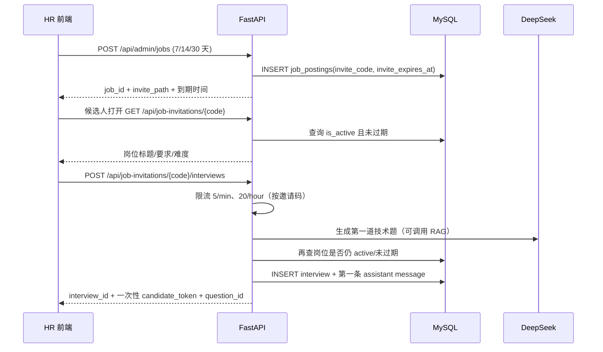
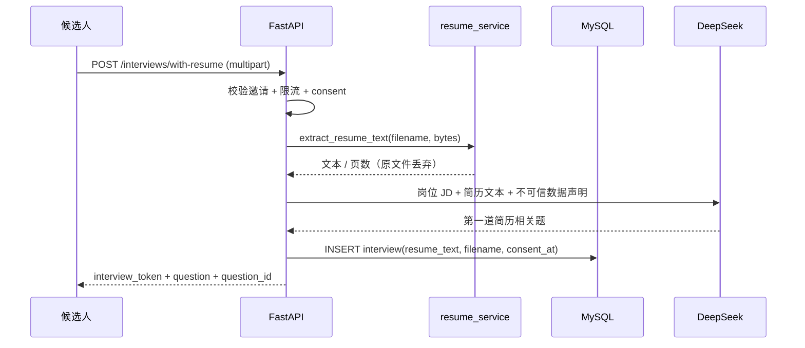
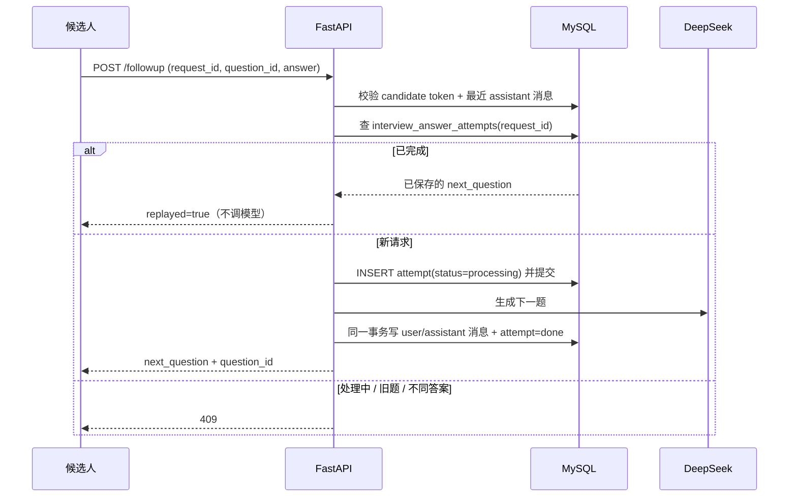
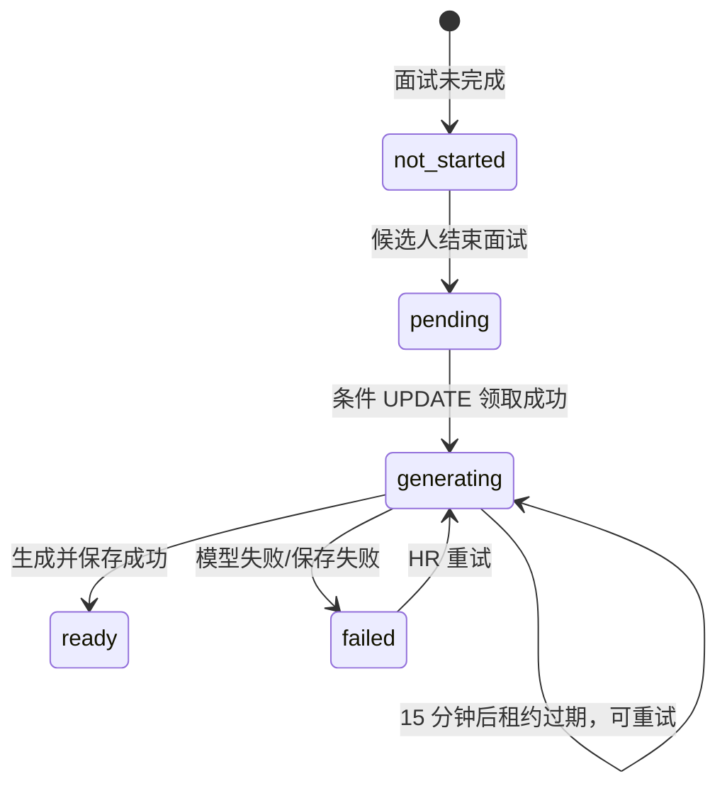
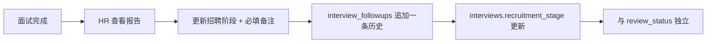

# InterviewPilot 架构说明

本文记录 InterviewPilot V2.3 的请求链路、关键设计、失败处理和代码入口，目标是让阅读者在 15 分钟内理解“为什么这样写”，而不是只看到功能列表。

## 1. 系统边界

InterviewPilot 解决的是**招聘初筛**，不是完整 HR 系统：

- 输入：HR 创建的岗位（名称、JD、难度、邀请有效期）+ 候选人姓名 + 可选简历。
- 处理：简历解析（只存文本）→ 8 轮四维文字面试 + 结构化评估 + HR 招聘跟进。
- 输出：带原文证据的辅助报告、招聘阶段/跟进历史、人工复核状态。
- 不做：自动录用/淘汰、背景调查、薪酬谈判、企业多租户。

## 2. 组件与职责

```text
React SPA
  ├── 候选人端：首页 / 邀请页 / 面试聊天
  └── HR 端：登录 / 岗位工作台 / 岗位详情 / 面试列表 / 面试详情
        │  fetch + Bearer Token（生产同源 /api，开发走 Vite proxy）
        ▼
FastAPI
  ├── main.py                 候选人面试、登录、报告入口
  ├── app/job_routes.py       岗位 CRUD、邀请码、有效期、邀请面试、简历面试
  ├── app/resume_service.py   PDF/DOCX 文本提取、大小/页数/类型限制
  ├── app/pipeline.py         招聘阶段、append-only 跟进历史
  ├── app/admin_workflow.py   HR 报告重试、人工复核
  ├── app/evaluation_workflow.py  报告状态机、租约、幂等
  ├── app/answer_idempotency.py   答题占位、重放、失败恢复
  ├── app/account_routes.py   受邀注册、试用申请、试用列表
  ├── app/hr_auth.py          受邀 HR 密码哈希/登录/JWT
  ├── app/model_usage.py      opt-in 模型用量 telemetry
  ├── app/structured_interview.py 四维阶段与证据校验
  ├── app/services/            Agent / RAG / 评估 / LLM client
  └── app/demo_routes.py       只读虚构 Demo
        │
        ├── MySQL：jobs / interviews / messages / evaluations /
        │           interview_followups / interview_answer_attempts
        ├── Chroma：岗位知识向量
        ├── DeepSeek / DashScope：LLM 与 Embedding
        └── ~/.interviewpilot/model_usage.jsonl（可选）
```

### 分层职责

| 层 | 负责 | 不负责 |
| --- | --- | --- |
| React | 页面、表单、聊天、HR 工作台 | 不持有 API Key，不直接调模型 |
| FastAPI 路由 | 鉴权、参数校验、业务编排 | 不写复杂 Prompt |
| Service | Prompt、Agent、RAG、评估 | 不处理 HTTP 状态码 |
| SQLAlchemy | 持久化、事务、条件更新、行锁 | 不判断业务对错 |
| MySQL | 约束、唯一键、原子更新 | 不存业务规则 |
| Chroma | 向量相似度检索 | 不做业务鉴权 |
| DeepSeek | 生成问题/评估 JSON | 不决定面试阶段 |

## 3. 关键请求链路

### 3.1 创建岗位与邀请面试



关键点：

- 岗位、难度、JD 来自数据库，候选人请求体只有姓名。
- 过期链接返回 `410`，停用链接返回 `404`；两者在 AI 调用前拒绝。
- 迁移后旧岗位获得 7 天宽限期；`NULL` 失败关闭（视为不可用）。
- `candidate_token` 只返回一次；数据库保存 SHA-256 哈希，不保存明文。

### 3.1.1 简历上传与简历驱动首题（V2.2）



关键点：

- 上传在**创建面试之前**完成，首题就能结合简历；不需要“先创建再删题”。
- 原文件只在内存中存在；数据库只保存 `resume_text`、`resume_filename`、`resume_consent_at`。
- 简历文本截断到 8000 字，PDF 限 20 页、文件限 5 MB；DOCX 额外限制解压后 20 MB。
- 扫描版 PDF 没有文字层时返回 400，不做 OCR。
- 后续追问通过 `resume_text` 传入 Prompt；评估只把简历当背景，证据必须来自面试回答。

### 3.2 答题幂等与恢复



为什么先落库再调模型？

- 如果先调模型、后写库，客户端超时重试会再次调用模型，造成重复计费。
- 唯一约束 `(interview_id, question_id)` 在数据库层串行化同一道题的竞争请求。
- 15 分钟租约允许 worker 崩溃后重试；同一 `request_id` 重放返回已提交结果。
- `complete` 只拦截**租约内**的 `processing`，避免崩溃残留永久阻止结束面试。

### 3.3 报告生成



报告只由候选人触发一次，HR 可在失败或缺失时重试；两条路径复用 `generate_and_store_report`。

### 3.4 招聘阶段与跟进



- 阶段枚举：`new / contact / next_round / decision / closed`。
- `SELECT ... FOR UPDATE` 锁面试行，保证“读旧阶段 + 写历史 + 更新阶段”原子。
- 只追加、不覆盖历史；备注是流程事实，不是 AI 推断。
- Demo 路由只读虚构阶段，不能写真实 pipeline。

## 4. 设计决策与取舍

### 4.1 为什么用固定状态机，而不是让 Agent 自主决定面试流程？

**问题**：如果让模型自己决定“下一题问技术还是软技能”，它倾向于沿着技术细节一直追问，导致沟通/学习/执行维度没有数据，评估报告只能编。

**选择**：服务端按 `answer_count` 选择阶段，模型只负责“把这一阶段问好”。

**代价**：对话自由度下降；如果候选人在技术题上表现很好，也无法临时增加技术题。

**适用边界**：招聘初筛需要标准化和可比较性，这一取舍是合理的；如果是模拟练习产品，可以放开。

### 4.2 为什么 RAG 用 Tool Calling，而不是每次把知识库拼进 Prompt？

**问题**：知识库变大后，全量拼接会占用上下文、增加成本，并引入无关内容。

**选择**：只暴露一个检索工具，让模型按需调用；检索结果作为 `ToolMessage` 回填。

**代价**：模型可能不调用工具，或调用时 query 写得不好；需要 Prompt 引导和后续评测。

**当前实现**：单轮工具调用（模型请求工具 → 执行 → 再让模型生成最终回答），不是多轮 ReAct 循环。这样成本可控，也避免工具调用失控。

### 4.3 为什么证据要逐字匹配？

**问题**：LLM 评估很容易写出“候选人展现了优秀的沟通能力”，但候选人根本没说过。HR 无法逐条核对，就会把幻觉当事实。

**选择**：要求模型返回 `evidence`，后端用 `quote in answer` 校验；不匹配就把该维度分数置空。

**代价**：模型改写、加标点、跨句摘录都会导致校验失败，召回率偏低。

**为什么仍然值得**：招聘场景宁可“少给一个分”，也不能“给一个假分”。后续可以引入模糊匹配/语义相似度，但必须保留人工复核。

### 4.4 为什么报告生成用数据库租约，而不是直接上 Redis/队列？

**问题**：并发点击“生成报告”会重复调用 LLM，产生重复费用和重复报告。

**选择**：用 MySQL 条件 `UPDATE` 原子领取槽位；`evaluation_started_at` 作为 15 分钟租约；写回前再次比较时间戳。

**代价**：同步请求会占用一个 worker 直到模型返回；进程崩溃后只能“过期重试”，不能自动续跑。

**为什么当前够用**：单机、低并发、报告生成耗时可控；引入队列会增加部署复杂度。代码把这个边界写在 README 里，而不是假装它是生产级异步系统。

### 4.5 为什么答题也要幂等？

**问题**：候选人点击提交后网络超时，前端重试；如果后端已经调用过模型，第二次重试会再次计费，甚至写出重复消息。

**选择**：`request_id + question_id` 作为客户端幂等键；数据库唯一约束 + 先占位后调用 + 完成后缓存响应。

**代价**：多了一张表、一次事务和前端 `sessionStorage` 状态；旧客户端不带 `request_id` 时只能用 `uuid5(interview_id, question_id, answer_hash)` 兼容。

**边界**：它不是“外部 LLM exactly-once”的证明；如果模型已经返回但进程在写库前崩溃，仍可能需要重试。它保证的是**应用层不会重复写消息/重复返回不同结果**。

### 4.6 为什么邀请有效期放在岗位表？

**问题**：共享邀请码长期有效，被转发或泄露后会持续产生 AI 调用费用。

**选择**：`job_postings.invite_expires_at`，创建时按 7/14/30 天写入；所有入口在 AI 调用前检查。

**代价**：到期后 HR 需要重新创建岗位/邀请；没有“续期”按钮（后续可加）。

**为什么 NULL 视为过期**：迁移/异常情况下，失败关闭比默认永久有效更安全。

### 4.7 为什么招聘阶段和 AI 复核分开？

- `recruitment_stage` 是 HR 手动记录的流程事实：有没有联系、是否进下一轮、是否结束。
- `review_status` 是 HR 对 AI 报告的复核状态：待复核、已复核、需跟进。
- 两者语义不同，混在一起会让“AI 报告已看”被误读成“候选人已进入下一轮”。

### 4.8 为什么 AI 用量记录默认关闭？

- 记录 Token/费用涉及运维与隐私边界；默认关闭，显式 `MODEL_USAGE_ENABLED=1` 才启用。
- 只写元数据，不写消息正文、密钥、邀请码或原始响应。
- 失败调用 Token 未知时写 `null`，不伪造 0；日志写入失败只 warning，不影响面试。
- 费用是按单价估算，不是云账单。

### 4.9 三类身份，三条认证路径

| 身份 | 凭证 | 能做什么 | 不能做什么 |
| --- | --- | --- | --- |
| HR 管理员 | bcrypt 密码 + 2 小时 JWT | 建岗、看所有面试、报告、招聘阶段、人工复核 | 无 |
| 候选人 | 每场面试随机 Token，库中存 SHA-256 | 只能读写自己的面试与问答 | 读取 HR 报告、访问他人面试 |
| Demo 访客 | 独立 JWT，只读 | 查看预置虚构数据 | 访问真实 HR API、触发模型调用 |

## 5. 失败处理矩阵

| 故障 | 当前行为 | 用户看到 | 恢复方式 |
| --- | --- | --- | --- |
| 邀请过期 | 410，AI 调用前拒绝 | 邀请已过期 | HR 重新建岗 |
| 岗位停用 | 404 | 邀请无效 | HR 重新启用/新建 |
| DeepSeek 超时/报错 | 首题/追问 502/504 | 提示稍后重试 | 重新提交 |
| 答题请求超时 | 前端保留 request_id | 可用原回答重试 | 重放同一 request_id |
| 两个请求抢同一道题 | 唯一约束 + 409 | 正在处理/已提交 | 刷新/重放 |
| 报告生成失败 | 状态写 `failed` | HR 看到“生成失败” | HR 重试 |
| 两个请求同时生成 | 只有一个 `rowcount=1` | 另一个 409 | 刷新查看 |
| 生成 worker 崩溃 | 15 分钟后租约过期 | 状态最终显示 failed | HR 重试 |
| 答题 worker 崩溃 | 15 分钟后可重试；结束不再被永久阻塞 | 可重试/结束 | 重放或结束 |
| 候选人猜 interview_id | Token 不匹配 | 401 | 无 |
| 候选人读 HR 报告 | `require_admin` 拦截 | 401 | 无 |
| Demo 写真实 pipeline | `require_admin` 拦截 | 401 | 无 |
| 登录爆破 | 5 次/5 分钟，锁 15 分钟 | 429 | 等待 |
| 邀请码被刷 | 5 次/分钟、20 次/小时 | 429 | 等待 |

## 6. 数据模型

```text
job_postings 1 ── n interviews 1 ── n messages
                         │
                         ├── 1 evaluations
                         ├── n interview_followups
                         └── n interview_answer_attempts
                                  │
                                  └── question_id → messages.id
```

- `hr_users`：V2.3 受邀 HR 账号；邮箱唯一、bcrypt 密码哈希、`active/disabled`。
- `trial_requests`：V2.3 试用申请，只有 `pending`，人工审核后线下发邀请码。
- `interviews.resume_text / resume_filename / resume_consent_at`：V2.2 简历文本、展示文件名与同意时间；不保存原文件。
- `interviews.job_id` 可空：兼容 V1 没有岗位来源的旧面试。
- `evaluations.interview_id` 唯一：一场面试最多一份报告。
- `interview_answer_attempts` 对 `(interview_id, question_id)` 唯一：一道题最多一次成功提交。
- `interview_followups` append-only：保留阶段变化和备注历史。
- 迁移是显式 SQL（`backend/migrations/`），没有 Alembic；生产化时应补迁移工具。

## 7. 代码阅读顺序

如果要在面试前快速讲清楚项目，建议按这个顺序读：

1. `backend/app/models.py`：六张表/关系与唯一约束、简历字段。
2. `backend/app/job_routes.py`：岗位、邀请码、有效期、创建面试、简历面试。
3. `backend/app/resume_service.py`：PDF/DOCX 解析与边界限制。
4. `backend/app/answer_idempotency.py`：答题占位、重放、租约。
5. `backend/main.py` 的 `interview_followup`：鉴权 → 幂等 → 状态机 → 模型 → 事务。
6. `backend/app/structured_interview.py`：阶段与证据校验。
7. `backend/app/services/agent_service.py`：Prompt、简历注入、历史、工具调用。
8. `backend/app/services/rag_service.py`：知识库检索。
9. `backend/app/account_routes.py` + `hr_auth.py`：受邀注册、HR 登录、试用申请。
9. `backend/app/evaluation_workflow.py`：报告并发与失败恢复。
10. `backend/app/services/evaluation_service.py`：结构化评估与简历边界。
11. `backend/app/pipeline.py`：招聘阶段与跟进历史。
12. `backend/app/model_usage.py`：用量 telemetry。
13. `frontend/src/App.tsx` 与 `src/pages/`：端到端 UI。
14. `backend/tests/`：每个设计决策对应的回归测试。

## 8. 已知不足

- 知识库规模小，未做 Recall@K、问题重复率等离线评测。
- 评估只做逐字证据校验，没有做语义一致性校验。
- 限流是单进程内存，无法跨 worker 共享；Nginx 反代下登录限流 IP 可能是代理地址。
- 没有 token/成本看板、审计日志、数据保留策略；用量日志没有自动轮转。
- 没有 CI、E2E 测试和容器化部署。
- 简历文本没有 TTL/删除接口/字段加密，PII 保留策略尚未实现；扫描版 PDF/OCR 未支持。
- 受邀 HR 共享同一工作区，没有 owner 级数据隔离、每账号 AI 配额、邮箱验证/找回密码；禁用账号的 JWT 在 2 小时内仍可能有效。
- 招聘阶段没有“续期邀请”或批量操作；邀请码仍是共享凭证。

这些不足不影响“跑通业务闭环”，但决定了它现在适合作为作品集/原型，而不是直接商用。
